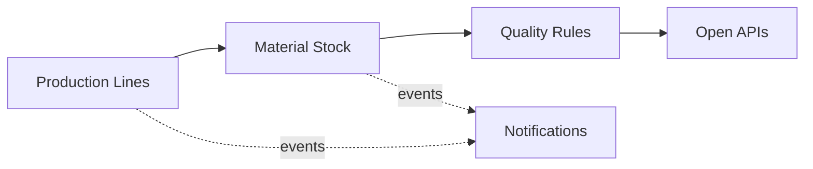

# Domain Model and Bounded Contexts

Ubiquitous language and context design (view VP-4). Domain-standard concepts are mapped
normatively in `../domain/domain-standards.md` (CR-5).

## Ubiquitous language (selected terms)

| Term | Meaning |
|---|---|
| **Production line** | An assembly, machining, packaging or painting line at a plant |
| **Material stock** | The guarded available-units account of a plant store |
| **Material issue** | One issue of material to production, by material type |
| **Quality rule** | A decision rule binding a product family to batch and defect envelopes |
| **Equipment** | A CNC, robot, press or conveyor in the registry (AAS posture) |
| **Downtime risk score** | A transparent 0-100 equipment risk score |

## Bounded contexts and invariants

### Production Lines — `production-line-service`
Production line registry per plant. Lifecycle: `RUNNING` → transitions
pause, retire. Production data is commercially sensitive operational data; worker personal data stays in adopter systems. All data here is synthetic.

### Material Stock — `material-stock-service`
Guarded material stock per plant and the issues to production against it. **Invariant (ADR-0004): material issued to production never exceeds available stock — an issue that would overrun stock is rejected (422) and records nothing, so work orders never run on phantom material.** Consumption records are
append-only evidence; a rejected operation records nothing.

### Quality Rules — `quality-rules-service`
Decision rules binding product families to batch-size and defect envelopes. Only ACTIVE rules decide; evaluation order is by priority; every decision
is ALLOWED / DEGRADED / DENIED with the matched rule and a human-readable reason.

### Equipment — `equipment-catalog-service`
Equipment registry (Asset Administration Shell posture).

### Notifications — `notification-service`
Delivery trail for audit; recipients are never logged.

## Context map

